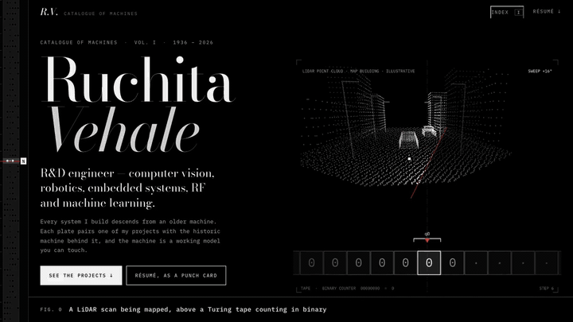

# Ruchita Vehale — Catalogue of Machines

**Live site: [www.ruchita.uk](https://www.ruchita.uk)**

[](https://www.ruchita.uk/walkthrough.mp4)

▶ **[Watch the full walkthrough](https://www.ruchita.uk/walkthrough.mp4)** (MP4, about 2½ minutes, plays in the browser): all thirteen plates on desktop, then a short pass on a phone.

A hand-built static site: plain HTML, CSS and ES modules. **No framework, no build step, no runtime network
dependencies except Google Fonts.** Everything is in [`site/`](site/).

Concept: each plate leads with one of her projects, drawn as a small animated model of what it actually does
(defect-inspection mesh, DriveSense pipeline, dynamic SLAM, precision landing, antenna sweep, …), then pairs it with
the older machine it descends from — twelve working models (Turing machine, camera obscura, Jacquard loom, sea
chart, gyroscope, spark-gap telegraph, difference engine, core memory, switchboard, Antikythera dial, Hollerith
card, Enigma) plus a card catalogue of the papers. Project illustrations are labelled "illustrative" and carry no
invented figures.
Palette: black, greys, white, and one small red accent per drawing (the switchboard's patch cords are the one place red is used freely).

```
site/
  index.html          the whole catalogue — every description of her work is plain HTML (survives without JS)
  css/styles.css      design system
  js/main.js          lazy-mounts each plate, wires the HTML controls to the plate APIs
  js/core.js          scene runner (one rAF loop, visible-only), line-art helpers
  js/tape.js          fixed ITA2 paper tape, fed by scroll
  js/flap.js          split-flap metrics board
  js/panel.js         Altair-style front panel + index overlay
  js/lib/*.js         pure machine logic (Enigma, Turing, codes) — no DOM
  js/plates/*.js      one canvas per plate (hero + twelve machines); the hero is a LiDAR scan (hero-lidar.js)
                      above a Turing tape (hero.js)
  js/projects/*.js    the project illustration beside each plate's description (dego, drive, apple, slam,
                      landing, antenna, follow, firmware)
  files/              résumé PDF
```

## Run locally

```bash
python3 -m http.server 8137   # from the repo root
# open http://localhost:8137/site/
```

Small screens are handled in `css/styles.css` (width breakpoints at 1060, 846, 760, 400 and 360 px, plus a `(pointer: coarse)` block for touch) and in each scene's own narrow-width branch in `js/plates/` and `js/projects/`. Desktop rules are untouched by those blocks. Checked at 320, 360, 375, 390, 414, 430, 540, 667, 768, 844 and 1024 px with no horizontal overflow.

Flags: `?debug` shows an fps counter · `?motion=0` pauses animation (same as `prefers-reduced-motion`); plates redraw when you interact with them.

## Edit

* **Text, numbers, descendants** — edit `site/index.html` (each plate has a `.desc` block).
* **Skill graph / timeline data** — `site/js/plates/switch.js` (projects and skills) and `site/js/plates/gears.js` (roles).
* **Résumé** — overwrite `site/files/Ruchita_Vehale_Resume.pdf`.
* **Walkthrough video** — `site/walkthrough.mp4` (served at www.ruchita.uk/walkthrough.mp4, because GitHub's file page
  will not play a video this size) and `docs/preview.gif` are recorded from the live site by
  `node tools/record-walkthrough.mjs <outDir>` (needs Node 22+, Chrome and ffmpeg; set `SITE_URL` to record another
  address). After re-recording, copy `walkthrough.mp4` from `<outDir>` into `site/` and `preview.gif` into `docs/`.
* **Paper links** — each card in `#drawer` has a `.pub` link to its `https://doi.org/…` permalink, which redirects to the publisher's page (authors, volume and pages were checked against Crossref).

## Verified machine logic

`js/lib` is plain, testable code. Known answers it satisfies: Enigma I (rotors I-II-III, reflector B, rings AAA,
start AAA) enciphers `AAAAA` as `BDZGO` and double-steps correctly; the 3-state busy beaver halts with six 1s in
14 steps; Hollerith zones follow 12 + 1–9 (A–I), 11 + 1–9 (J–R), 0 + 2–9 (S–Z); the difference engine's added
columns equal direct polynomial evaluation.

## Deploy

`.github/workflows/hugo.yml` uploads `./site` to GitHub Pages on every push to `main`
(Settings → Pages → Source → GitHub Actions). `netlify.toml` publishes `site` with no build command.
All paths are relative, so it also works under a `/<repo>/` subpath.

The earlier Hugo version (`content/`, `themes/`, `hugo.yaml`, `public/`, `archetypes/`) is still in the repo, unused.
